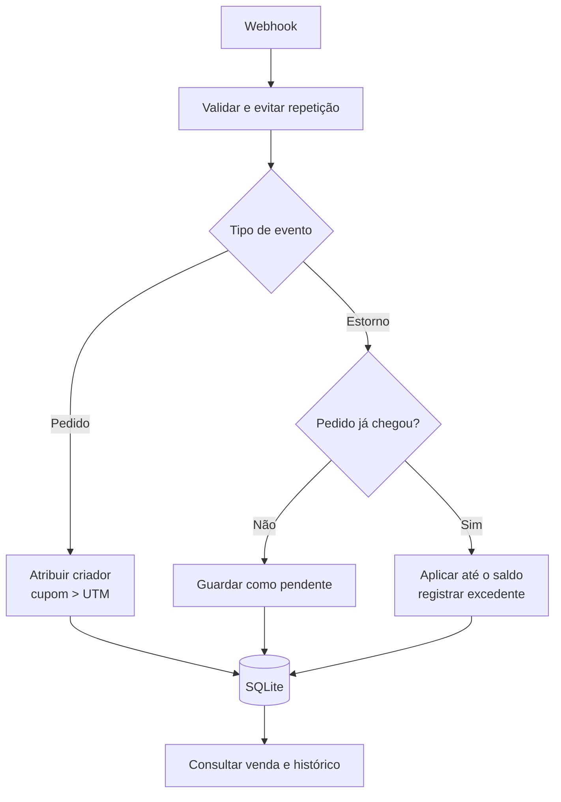

# Vendas atribuídas a criadores

[](https://github.com/leonardoperin14/conty-challenge-05-vendas/actions/workflows/ci.yml)

API local para processar webhooks simulados de pedidos pagos e estornos, atribuir vendas a criadores e manter um histórico financeiro rastreável. Usa Fastify, TypeScript e SQLite; os valores monetários são armazenados em centavos de BRL.

## Fluxo da solução



### Garantias principais

| Caso | Comportamento |
| --- | --- |
| Webhook de pedido repetido | Mesmo ID e mesmos dados retornam `duplicate: true`; a venda não é somada novamente. |
| Mesmo ID com dados diferentes | Retorna `409 Conflict`. |
| Atribuição | Cupom conhecido tem prioridade; se não houver, usa `utm.content`; sem sinal conhecido, fica sem criador. |
| Estorno parcial ou repetido | Cada estorno fica registrado; reentrega do mesmo evento não o aplica outra vez. |
| Estornos acima do valor da venda | Aplica somente o saldo disponível e registra o restante como excedente (`CLAMPED`). |
| Estorno antes do pedido | Fica como `PENDING_ORDER` e é reconciliado quando o pedido chega. |

## Executar localmente

Requer Node.js 24 ou superior e npm. O banco padrão é `data/vendas.sqlite`; `DB_PATH` permite escolher outro caminho. `SEED_DEMO=true` semeia as regras de demonstração ao iniciar o servidor.

```bash
npm ci
npm run seed
npm run dev
```

O servidor inicia em `http://localhost:3000`. Comandos disponíveis:

```bash
npm test        # executa os testes
npm run build   # compila e verifica os tipos
npm run check   # executa build e testes
npm start       # inicia a versão compilada
```

`npm run seed` cadastra Maria (`MARIA10` → `creator_01`) e João (`JOAO15` → `creator_02`). Também é possível iniciar com `SEED_DEMO=true npm run dev`.

## Endpoints

| Método e rota | Uso | Respostas principais |
| --- | --- | --- |
| `POST /webhooks/orders` | Recebe pedido pago em BRL | `201` criado, `200` repetido, `409` conflito, `400` inválido |
| `POST /webhooks/refunds` | Recebe estorno | `201` aplicado, `202` aguardando pedido, `200` repetido, `409` conflito |
| `GET /orders/:id/attribution` | Consulta atribuição, valores e histórico de estornos | `200` encontrado, `404` inexistente |

## Exemplos

O pedido abaixo envia um cupom de Maria e um UTM de João. Em caso de conflito, o cupom conhecido vence: a resposta atribui a venda a `creator_01`, com `attribution_source: "coupon"`.

```bash
curl -X POST http://localhost:3000/webhooks/orders \
  -H 'Content-Type: application/json' \
  -d '{"id":"order_1001","total_cents":20000,"currency":"BRL","status":"paid","coupon":"MARIA10","utm":{"source":"instagram","campaign":"summer","content":"creator_02"}}'
```

Um estorno parcial de R$ 50,00 sobre o pedido de R$ 200,00:

```bash
curl -X POST http://localhost:3000/webhooks/refunds \
  -H 'Content-Type: application/json' \
  -d '{"id":"refund_001","order_id":"order_1001","amount_cents":5000}'
```

A resposta do estorno inclui `applied_cents`, `excess_cents`, `status` e os horários de recebimento e aplicação. A consulta `GET /orders/order_1001/attribution` retorna o pedido, a receita líquida atribuída — neste exemplo, 15.000 centavos — e todos os estornos relacionados.

## Como os requisitos são cobertos

| Requisito do desafio | Implementação e cobertura |
| --- | --- |
| API e README | API Fastify descrita acima; este README documenta execução, regras, rotas e exemplos. |
| Pedido duplicado não conta duas vezes | `test/api.test.ts`: “creates a single attributed sale when the order webhook is repeated”. |
| Testes de pedido duplicado e de estorno | `test/api.test.ts` cobre reentrega, conflito de IDs e processamento de estornos. |
| Estorno parcial e repetido | “applies partial and total refunds once and records the amount above the sale”, em `test/api.test.ts`. O caso repete o mesmo ID e verifica que o valor aplicado não muda. |
| Estornos não excedem a venda e ficam rastreáveis | O mesmo teste verifica estorno excedente e histórico; `test/concurrency.test.ts` cobre estornos concorrentes. |
| Estorno que chega antes do pedido | “preserves an early refund and applies it when the order arrives”, em `test/api.test.ts`; também há cobertura para vários estornos pendentes. |
| Regra de desempate centralizada e testada | `src/attribution.ts` contém a regra; `test/attribution.test.ts` verifica que cupom conhecido vence UTM de outro criador. |
| Sem integração Shopify real | Webhooks são simulados por chamadas HTTP locais e testes Fastify, sem credenciais de loja. |

## Limites conhecidos

A solução aceita somente pedidos `paid` em BRL e usa uma loja fixa (`default-shop`). O banco protege IDs únicos, aplica as operações financeiras em transações e impõe que a soma dos estornos aplicados não ultrapasse o total do pedido. Pedidos existentes não aceitam alteração de total ou status. A API não implementa autenticação nem assinatura de webhook.

## Validação registrada

Na validação documentada da entrega, `npm test` passou com 13 testes em 3 arquivos; `npm run build`, `npm run check` e `npm run seed` também concluíram. `npm ci` instalou 90 pacotes e não reportou vulnerabilidades. Uma primeira execução de testes sob concorrência excedeu o limite de tempo de um caso; a repetição isolada passou. O npm também exibiu um aviso `allow-scripts` para `esbuild`.

## Uso de IA e revisão

Usei o Codex para implementar a API e os testes e para ajudar com a documentação. Também pedi uma revisão técnica a outra sessão do Codex.

Eu defini a abordagem e os pontos de controle, acompanhei os resultados de build e testes e autorizei os ajustes da entrega. Não revisei o código linha por linha nem executei os testes manualmente; os resultados acima vêm das execuções automatizadas.
